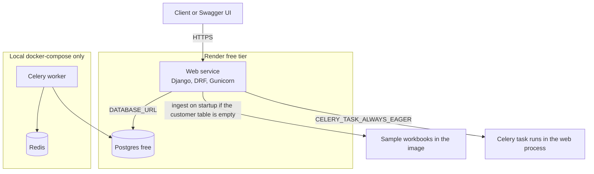
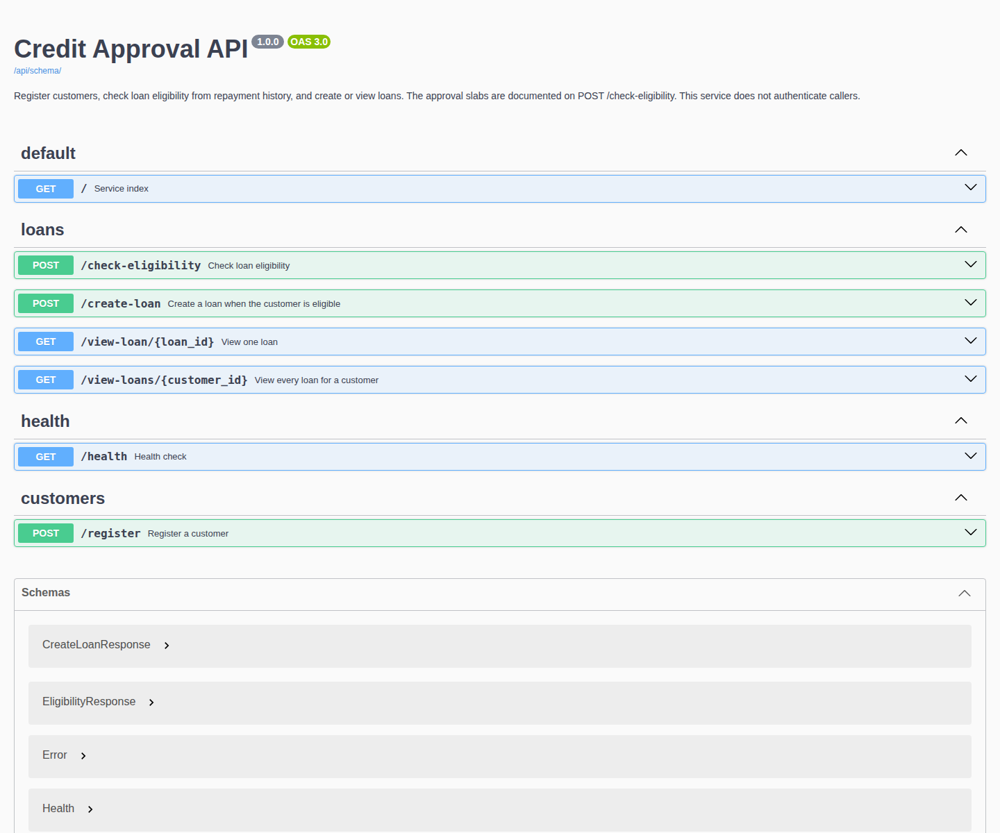
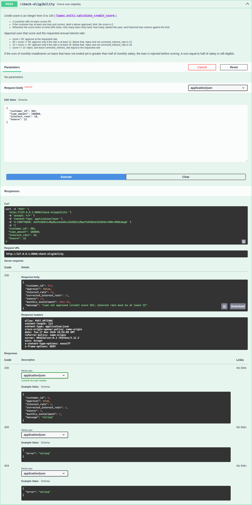
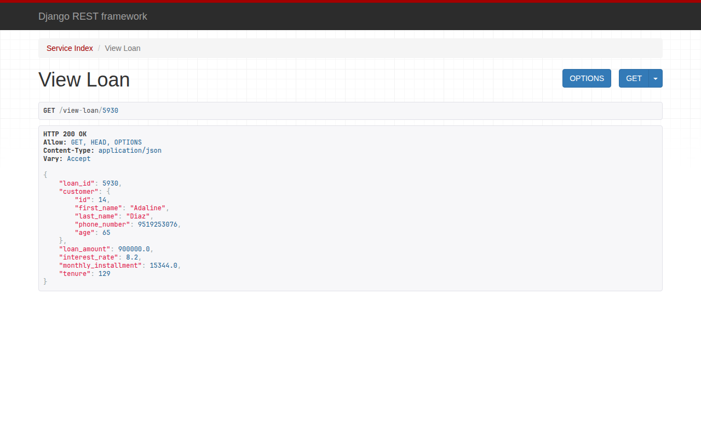
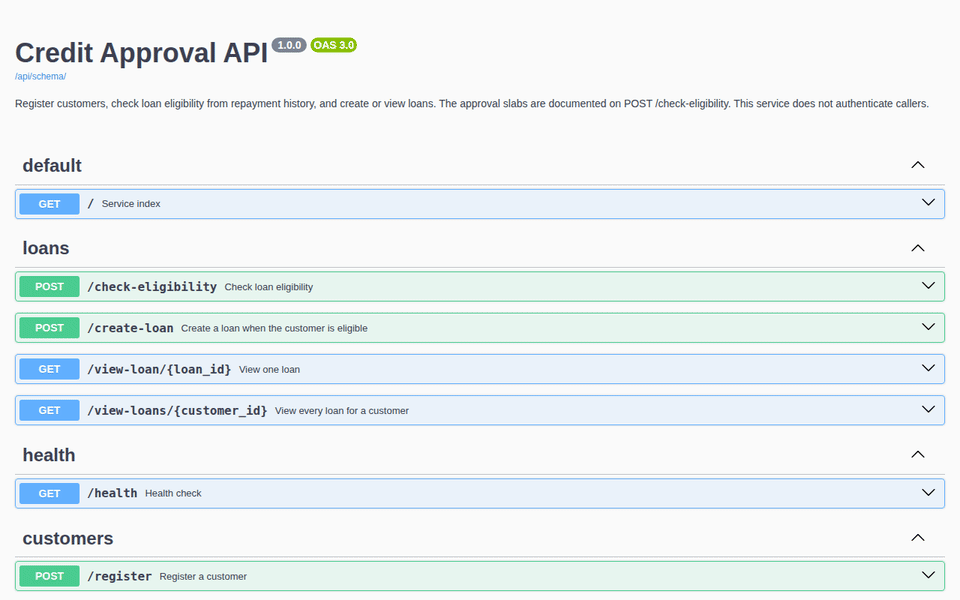

# Credit Approval API

A Django REST API that registers customers, scores a loan request from their repayment history, and stores the loan when the request clears the salary and interest-rate rules.

[](https://github.com/Anshul3977/credit-approval-system/actions/workflows/ci.yml)

## Live demo

The API is live at https://credit-approval-api-e0a8.onrender.com.

Interactive docs: https://credit-approval-api-e0a8.onrender.com/api/docs/.

[](https://dashboard.render.com/blueprint/new?repo=https://github.com/Anshul3977/credit-approval-system)

The button reads `render.yaml` from the default branch. Deploy steps and environment variables are in [Deploy on Render](#deploy-on-render).

## Architecture



Render's free plan has no background workers, so the hosted app does not run Redis. Local `docker compose` still runs Redis and a Celery worker, which is the original design. The trade-off is in [Design decisions](#design-decisions).

## Features

- `POST /register` creates a customer. `approved_limit` is `36 * monthly_income`, rounded to the nearest lakh (`100000`) with Python's `round`.
- `POST /check-eligibility` returns approval, the requested rate, a corrected rate, tenure, and the EMI.
- `POST /create-loan` saves the loan when the same rules pass, and adds the loan amount to `current_debt`. A rejection is HTTP 200 with `loan_approved: false`.
- `GET /view-loan/<loan_id>` returns one loan plus the customer.
- `GET /view-loans/<customer_id>` returns that customer's loans and `repayments_left`.
- `GET /health` checks the process and the database.
- `GET /api/docs/` is Swagger UI. `GET /api/schema/` is the OpenAPI document.
- Startup loads `data/customer_data.xlsx` and `data/loan_data.xlsx` when the database has no customers.

Paths have no trailing slash.

## Approval rules

The score is an integer from 0 to 100, computed in `backend/loans/utils.py`.

- A customer with no loans scores **50**.
- If the customer has at least one loan and `current_debt` is above `approved_limit`, the score is **0**.
- Otherwise the score is the weighted sum of four components, truncated toward zero:
  - share of EMIs paid on time, capped at 100%, weight 0.4
  - `max(0, 40 - 5 * number of loans)`, weight 0.2
  - `max(0, 30 - 10 * loans whose start date is this calendar year)`, weight 0.2
  - historical loan volume against `approved_limit`, clamped to 0..50, weight 0.2

Because "this calendar year" is part of the score, a stored customer's score can change on 1 January. A customer with no loans stays at 50.

Interest-rate slabs, using that integer:

| Score | Decision |
| --- | --- |
| greater than 50 | Approve at the requested rate |
| 31 to 50 | Approve only if the rate is at least 12. If it is lower, reject and set `corrected_interest_rate` to 12 |
| 11 to 30 | Approve only if the rate is at least 16. If it is lower, reject and set `corrected_interest_rate` to 16 |
| 10 or below | Reject. `corrected_interest_rate` stays the requested rate, because a higher rate would not approve the loan |

A new customer scores 50, so the minimum rate is 12%.

Before scoring, if the sum of monthly installments on loans whose `end_date` is still in the future is **greater than** half of monthly salary, the loan is rejected. A sum equal to half of salary is still eligible. The check uses loans that already exist. It does not add the EMI of the loan being requested.

`/register` is the only path that calculates `approved_limit`. Rows loaded from the workbook keep the Approved Limit column. Customer 1 in `data/customer_data.xlsx` is Aaron Garcia, monthly salary 50000, approved limit 4500000. Registering a new customer with monthly income 50000 returns `approved_limit` 1800000.

The EMI is the standard reducing-balance formula. At a 0% annual rate it is principal divided by tenure. A known value locked by the tests: 100000 at 14% for 12 months is 8978.71. A new customer's 100000 request at a corrected 12% for 12 months is 8884.88.

Newly created loans set `end_date` to the start date plus `tenure * 30` days.

## Stack

- Python 3.11, Django 4.2, Django REST Framework
- PostgreSQL 16
- Celery. Redis only when a worker is running
- drf-spectacular for OpenAPI, WhiteNoise for static files
- Gunicorn in production, `runserver` when `DJANGO_DEBUG=true`
- Docker and GitHub Actions

## Quickstart

Docker Compose runs Postgres, Redis, the API, and a Celery worker. The local database password below is only for that Compose network.

```bash
git clone https://github.com/Anshul3977/credit-approval-system.git
cd credit-approval-system
docker compose up --build
```

- API: http://localhost:8000
- Docs: http://localhost:8000/api/docs/
- Health: http://localhost:8000/health

The first boot migrates and loads the workbooks. Later boots skip ingest while any customer row exists. Copy `.env.example` to `.env` to override the defaults.

To exercise the worker explicitly:

```bash
docker compose exec web python -c "from customers.tasks import ingest_initial_data; ingest_initial_data.delay()"
```

With the Compose defaults, that call is published to Redis and the `celery` service runs it. The startup ingest does not use the queue. It calls `python manage.py ingest_data` directly.

Run the same process layout as Render, still with Compose's Postgres:

```bash
CELERY_TASK_ALWAYS_EAGER=true CELERY_BROKER_URL=memory:// docker compose up --build db web
```

`web` still depends on Redis in this file, so Redis starts, but eager mode does not publish to it.

Without Docker, from the repo root, with Postgres already running:

```bash
python3.11 -m venv .venv
source .venv/bin/activate
pip install -r requirements-dev.txt
export DJANGO_SECRET_KEY=dev-only-not-for-production
export DJANGO_DEBUG=true
export POSTGRES_HOST=127.0.0.1 POSTGRES_PASSWORD=postgres
export CELERY_TASK_ALWAYS_EAGER=true CELERY_BROKER_URL=memory://
python backend/manage.py migrate
python backend/manage.py ingest_data
python backend/manage.py runserver 0.0.0.0:8000
```

## curl examples

These bodies were captured on a local database immediately after loading the bundled workbooks. Customer ids in the files are 1 through 300, so the first `/register` is customer 301. The first loan created after ingest received id 10762 because 10761 was the highest ingested loan id. A fresh database produces the same ids. Paths have no trailing slash.

Ingested loan 5930, from the Loan ID column in `data/loan_data.xlsx`:

```bash
curl http://localhost:8000/view-loan/5930
```

```json
{
  "loan_id": 5930,
  "customer": {
    "id": 14,
    "first_name": "Adaline",
    "last_name": "Diaz",
    "phone_number": 9519253076,
    "age": 65
  },
  "loan_amount": 900000.0,
  "interest_rate": 8.2,
  "monthly_installment": 15344.0,
  "tenure": 129
}
```

Register, then a 10% request, then a 14% request, then create:

```bash
curl -s -X POST http://localhost:8000/register \
  -H 'Content-Type: application/json' \
  -d '{"first_name":"Asha","last_name":"Rao","age":28,"monthly_income":50000,"phone_number":9811100001}'
```

```json
{
  "customer_id": 301,
  "name": "Asha Rao",
  "age": 28,
  "monthly_income": 50000,
  "approved_limit": 1800000,
  "phone_number": 9811100001
}
```

```bash
curl -s -X POST http://localhost:8000/check-eligibility \
  -H 'Content-Type: application/json' \
  -d '{"customer_id":301,"loan_amount":100000,"interest_rate":10,"tenure":12}'
```

```json
{
  "customer_id": 301,
  "approval": false,
  "interest_rate": 10.0,
  "corrected_interest_rate": 12.0,
  "tenure": 12,
  "monthly_installment": 8884.88,
  "message": "Loan not approved (credit score 50); interest rate must be at least 12"
}
```

```bash
curl -s -X POST http://localhost:8000/check-eligibility \
  -H 'Content-Type: application/json' \
  -d '{"customer_id":301,"loan_amount":100000,"interest_rate":14,"tenure":12}'
```

```json
{
  "customer_id": 301,
  "approval": true,
  "interest_rate": 14.0,
  "corrected_interest_rate": 14.0,
  "tenure": 12,
  "monthly_installment": 8978.71
}
```

```bash
curl -s -X POST http://localhost:8000/create-loan \
  -H 'Content-Type: application/json' \
  -d '{"customer_id":301,"loan_amount":100000,"interest_rate":14,"tenure":12}'
```

```json
{
  "loan_id": 10762,
  "customer_id": 301,
  "loan_approved": true,
  "message": "Loan approved and created",
  "monthly_installment": 8978.71
}
```

```bash
curl http://localhost:8000/view-loans/301
```

```json
[
  {
    "loan_id": 10762,
    "loan_amount": 100000.0,
    "interest_rate": 14.0,
    "monthly_installment": 8978.71,
    "repayments_left": 12
  }
]
```

Unknown loan:

```bash
curl -i http://localhost:8000/view-loan/99999999
```

```json
{"error": "Loan not found"}
```

## Tests and CI

```bash
pip install -r requirements-dev.txt
export DJANGO_SECRET_KEY=ci-test-key
export POSTGRES_HOST=127.0.0.1 POSTGRES_PASSWORD=postgres
export CELERY_TASK_ALWAYS_EAGER=true CELERY_BROKER_URL=memory://
pytest
ruff check .
```

GitHub Actions (`.github/workflows/ci.yml`) runs three jobs on pull requests and on pushes to `main`: ruff, pytest against a Postgres 16 service, and `docker build`.

The tests cover register (including the lakh rounding and duplicate phones), every interest-rate slab, the 50% EMI boundary, create-loan, both view endpoints, unknown ids, malformed input, workbook ingest, eager Celery, and `DATABASE_URL` parsing.

## Deploy on Render

Free plan only. One web service and one Postgres database. No Key Value instance, because eager Celery does not need Redis. Render's free plan cannot run a background worker, and the pre-deploy command is only available on paid web services, so `scripts/start.sh` migrates, loads the sample data when the customer table is empty, and then binds Gunicorn to `0.0.0.0:$PORT`.

The live service at https://credit-approval-api-e0a8.onrender.com is a free Render web service in Singapore. Its database is a free Neon Postgres instance in Singapore, not Render Postgres, because this workspace already uses its one free Render Postgres database. The app connects with `DATABASE_URL` and `sslmode=require`.

1. Merge this branch to `main` so `render.yaml` is on the default branch.
2. Open [the Blueprint link](https://dashboard.render.com/blueprint/new?repo=https://github.com/Anshul3977/credit-approval-system) and apply it. Use a workspace that does not already have a free Render Postgres database. A workspace can have only one.
3. Wait for the Docker build and the first boot. The first boot loads 300 customers and 782 loan rows from the workbooks.
4. Open `https://<service-name>.onrender.com/api/docs/` and `https://<service-name>.onrender.com/health`.
5. Replace the live-demo paragraph at the top of this README with that URL.

Both resources are in `oregon` so the web service can use the database's internal URL. Keep them in the same region if you change it.

| Variable | Value | Why |
| --- | --- | --- |
| `DATABASE_URL` | from the database `connectionString` | Internal Postgres URL. The app prefers this over `POSTGRES_*`. |
| `DJANGO_SECRET_KEY` | `generateValue: true` | Render creates it. It is not in the repo. The process refuses to boot on Render if this is missing or still the dev placeholder. |
| `DJANGO_DEBUG` | `false` | Debug is off in production. |
| `ALLOWED_HOSTS` | `.onrender.com` | Django also appends `RENDER_EXTERNAL_HOSTNAME`. |
| `CELERY_TASK_ALWAYS_EAGER` | `true` | Tasks run inside the web process. No Redis. |
| `SEED_ON_START` | `if-empty` | Load the workbooks only when the customer table is empty, so a cold start does not reload Excel. `always` reloads. `false` skips. |
| `WEB_CONCURRENCY` | `1` | The free web instance has 512 MB of RAM. |
| `PYTHONUNBUFFERED` | `1` | Logs flush to Render. |
| `PORT` | set by Render | `scripts/start.sh` binds `0.0.0.0:$PORT`. Do not set this yourself. |

`DJANGO_SECRET_KEY` is the only generated secret. You do not paste a database password. Render injects `DATABASE_URL`.

## Design decisions

- Endpoints, response fields, and the slab boundaries are the ones this project already implemented. Below-slab requests are rejected and the response tells the caller the minimum rate. A score of 10 or below used to rewrite the rate up to 16% even though no rate would approve it. That rewrite is gone, and the message names the rate when the rate is the reason.
- `check-eligibility` and `create-loan` used to raise `TypeError` for any customer who already had loans, because the score mixed `Decimal` loan amounts with `float` weights. The score is Decimal end to end. Ingested customers can be scored.
- Ingest uses the workbook Loan ID. The old task stored `row index + 1`, so ids in the file did not match the API. The file reuses 29 loan ids for different loans. The first row keeps the original id. Each later row is stored under a stable id above every workbook id, so all 782 rows count toward the score and a second ingest updates the same rows. After ingest, Postgres sequences are moved past the highest explicit id. Without that, `/register` collided with an ingested customer id.
- `DATABASE_URL` is the production setting. `POSTGRES_*` remains for Compose. The old Compose file set `DATABASE_URL` and the settings module ignored it.
- Celery stays in the project. `CELERY_TASK_ALWAYS_EAGER` defaults to true when the broker URL is unset or is `memory://`. On Render it is set explicitly. Eager mode runs the task in the caller and does not retry, queue, or survive a crash. That is acceptable here because the sample load is a management command in the start script, not a queued job. Local Compose sets eager to false and runs a real worker.
- Gunicorn uses one worker on the free instance. Debug mode uses `runserver` so local Compose reloads the mounted source tree.
- The API is unauthenticated, matching the original project. Swagger UI is served from `drf-spectacular-sidecar` so the docs do not depend on a CDN.

## Limitations

- A free Render web service spins down after 15 minutes without traffic. The next request waits about a minute while it starts. Spin-down and redeploys wipe the local filesystem. Customer and loan rows live in Postgres.
- A workspace gets 750 free instance hours per calendar month. When those are used, Render suspends free web services until the next month.
- A free Render Postgres database expires 30 days after creation. There is then a 14-day grace period to upgrade it. After that, Render deletes the database and its data. Free databases have 1 GB of storage, no backups, and no managed connection pooling. Only one free database can exist in a workspace.
- There is no separate worker on the free plan, and no pre-deploy command. A long eager task would block the one Gunicorn worker. Ingest is kept out of the request path for that reason.
- The credit score is the heuristic above. It is not a bureau score.
- The API does not authenticate callers. Anyone who can reach it can register customers and create loans. Do not put real customer data in the hosted database.
- A new loan can push `current_debt` above `approved_limit`. The limit is applied on the next decision, using the debt from before that new loan is added.
- Phone numbers are JSON numbers, as in the original API.
- The screenshots and the curl bodies above are from a local run of this code. They are not measurements from a Render deploy.

## Screenshots

Taken locally against this branch, after the sample workbooks were loaded.





The response in that shot is customer 302, registered during the same local session, asking for 10% interest. The score is 50, so the corrected rate is 12 and the EMI shown is 8884.88.





## Secrets

No production credentials are committed on this branch. `.env` is gitignored. `.env.example` and Compose use `credit_dev_password` for the local Postgres container only.

The initial commit on `main` does contain two placeholders, and this branch does not rewrite history:

- `backend/credit_system/settings.py` had a Django `django-insecure-` secret key and defaulted the database password to `your_secure_password_123`.
- `docker-compose.yml` repeated that database password inside `DATABASE_URL`.

They are local placeholders, not cloud API keys. They remain reachable in git history. This branch reads the secret and the database URL from the environment instead.
